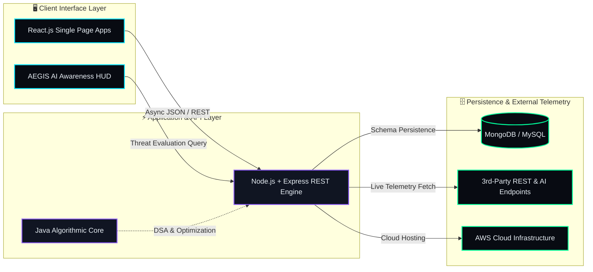
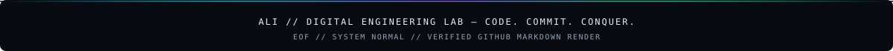

<!-- ===================== MOHD ALI KHAN — ALI // DIGITAL ENGINEERING LAB v3.0 ===================== -->

<div align="center">

  <!-- 1. CUSTOM ANIMATED SVG CYBER-HUD BANNER -->
  

  <!-- 2. LIVE TYPING TELEMETRY STREAM -->
  <a href="https://github.com/Mohd-Ali-Creator">
    
  </a>

  <br/>

  <!-- 3. COMMAND DECK NAVIGATION BADGES -->
  <a href="https://github.com/Mohd-Ali-Creator">
    
  </a>
  <a href="https://www.linkedin.com/in/mohdalikhan-dev/">
    
  </a>
  <a href="https://leetcode.com/MohdAliKhan">
    
  </a>
  

</div>


## ⚡ `01 // COMMAND CENTER DIAGNOSTICS`

<table>
<tr>
<td width="55%" valign="top">

### `> SYSTEM_PROFILE.exe`

### `> SYSTEM_PROFILE.exe`
```yaml
OPERATOR: Mohd Ali Khan (@Mohd-Ali-Creator)
INSTITUTION: KIET Group of Institutions (B.Tech CSIT)
PRIMARY_ROLE: Full-Stack Software Engineer
SECURITY_LAB: AEGIS AI (Cybersecurity Awareness)
ATHLETICS: National Taekwondo Player 🥋
MISSION_STATE: Open for SDE Internships & Open Source
```

**Engineering Directive:**
Build high-utility full-stack software, engineer resilient backend APIs, and design accessible cybersecurity tools—driven by the precision and discipline of national-level martial arts.

</td>
<td width="45%" valign="top">

### `> INTERACTIVE_HUD_CONTROLS`

_Click any diagnostic module below to expand live system specs:_

<details open>
<summary><b>🟢 [MODULE 01] Core Engineering Philosophy</b></summary>
<br/>

- **Deconstruct First:** Map data flow & failure states before writing code.
- **Zero Black Boxes:** Understand how systems operate beneath framework abstractions.
- **Security by Design:** Treat input validation & user awareness as first-class citizens.
</details>

<details>
<summary><b>🟣 [MODULE 02] Active 2026 Sprint Targets</b></summary>
<br/>

```diff
+ Advancing Java DSA (Graphs, DP, Trees)
+ Scaling AEGIS AI Threat Education Modules
+ Deploying Full-Stack Apps on AWS Cloud
! Studying Distributed System Design Patterns
```

</details>

<details>
<summary><b>🔵 [MODULE 03] Beyond the Terminal</b></summary>
<br/>

Competing as a **National Taekwondo Player** taught me that elite performance—whether on the mat or in production systems—comes down to reflexes, stress-testing, and relentless iteration.

</details>

</td>
</tr>
</table>


## 🛰️ `02 // TECHNICAL ECOSYSTEM & ARCHITECTURE`

<div align="center">
  <!-- Dynamic Animated Skill Dock -->
  
</div>

<br/>

<table>
<tr>
<td align="center" width="25%">
  <b>⚙️ LANGUAGES & CORE</b><br/><br/>
  <br/>
  <br/>
  <br/>
  <code>DSA • OOP • DBMS</code>
</td>
<td align="center" width="25%">
  <b>🎨 FRONTEND INTERFACES</b><br/><br/>
  <br/>
  <br/>
  <br/>
  <code>State Mgmt • REST Consumption</code>
</td>
<td align="center" width="25%">
  <b>🖧 BACKEND & DATA</b><br/><br/>
  <br/>
  <br/>
  <br/>
  <code>REST APIs • Auth • Schemas</code>
</td>
<td align="center" width="25%">
  <b>☁️ CLOUD & SECURITY LAB</b><br/><br/>
  <br/>
  <br/>
  <br/>
  <code>Cyber Awareness • Cloud Deploy</code>
</td>
</tr>
</table>

<details>
<summary><b>🧬 [INTERACTIVE BLUEPRINT] Click to Launch Live System Topology (Mermaid Engine)</b></summary>
<br/>



</details>


## 🚀 `03 // DEPLOYED ENGINEERING MODULES (PROJECTS)`

_Select any project card's interactive drawer (`▼`) to inspect its underlying architecture and engineering scope._

<table>
<tr>
<td width="50%" valign="top">

### 🛡️ `AEGIS AI`

**Cybersecurity Awareness & Threat Education Engine**


Bridges the human vulnerability gap by educating users on phishing mechanics, social engineering vectors, and safe digital hygiene through interactive AI-assisted workflows.

<details>
<summary><b>⚡ Inspect Architecture & Scope</b></summary>
<br/>

- **Core Problem:** Over 80% of security incidents originate from human deception rather than infrastructure zero-days.
- **Key Implementation:**
  - Interactive threat-recognition scenarios and phishing pattern breakdowns.
  - AI-assisted plain-language explanations of common web security risks.
  - _Scope Transparency:_ Engineered as an educational awareness platform, not a commercial firewall.
- **Stack:** `React` · `Node.js` · `JavaScript` · `AI APIs`
</details>

<br/>
<a href="https://github.com/Mohd-Ali-Creator?tab=repositories&q=AEGIS">
  
</a>

</td>
<td width="50%" valign="top">

### 📈 `ZERODHA CLONE`

**Full-Stack Brokerage & Portfolio Platform**


Full-stack financial trading interface and order management system modeled after India's largest brokerage platform, featuring multi-view dashboards and persistent MongoDB state.

<details>
<summary><b>⚡ Inspect Architecture & Scope</b></summary>
<br/>

- **Core Problem:** Synchronizing complex financial portfolio states, watchlists, and order execution across client and server.
- **Key Implementation:**
  - Dedicated public marketing platform + authenticated Kite-style trading console.
  - RESTful Express.js backend managing holdings, positions, and buy/sell order schemas in MongoDB.
- **Stack:** `React.js` · `Node.js` · `Express.js` · `MongoDB` · `CSS3`
</details>

<br/>
<a href="https://github.com/Mohd-Ali-Creator/Zerodha-Clone">
  
</a>

</td>
</tr>
<tr>
<td width="50%" valign="top">

### 🌦️ `WEATHER TELEMETRY ENGINE`

**Real-Time Meteorological Forecasting App**


Live environmental telemetry web app providing real-time temperature, wind velocity, humidity, and 5-day forecast matrices for global cities.

<details>
<summary><b>⚡ Inspect Architecture & Scope</b></summary>
<br/>

- **Engineering Focus:** Asynchronous REST API consumption, dynamic state updates, and graceful error handling for invalid city queries.
- **Stack:** `React.js` · `OpenWeather API` · `JavaScript (ES6+)` · `CSS3`
</details>

<br/>
<a href="https://github.com/Mohd-Ali-Creator/Weather_Website">
  
</a>

</td>
<td width="50%" valign="top">

### 🧠 `ALGORITHMIC LAB & OPEN SOURCE`

**Java Data Structures, Algorithms & Contributions**


Continuous implementation of core computer science data structures, algorithmic optimizations in Java, and collaborative open-source pull requests.

<details>
<summary><b>⚡ Inspect Architecture & Scope</b></summary>
<br/>

- **Core Focus:** Time/space complexity optimization, recursion, graph traversals, and clean OOP design patterns in Java.
- **Links:** Active problem solving tracked on LeetCode (`@MohdAliKhan`).
</details>

<br/>
<a href="https://leetcode.com/MohdAliKhan">
  
</a>

</td>
</tr>
</table>


## 📊 `04 // LIVE SYSTEM TELEMETRY & ACTIVITY MATRIX`

<div align="center">

  <!-- Row 1: Custom-Themed Cyber Telemetry Cards -->
  
  

<br/><br/>

  <!-- Row 2: Language Distribution + LeetCode Heatmap -->
  
  

</div>

<br/>

<details open>
<summary><b>🐍 [LIVE CONTRIBUTION MATRIX] Automated GitHub Commit Snake & Activity Graph (Click to Toggle)</b></summary>
<br/>

<div align="center">
  <picture>
    <source media="(prefers-color-scheme: dark)" srcset="https://raw.githubusercontent.com/Mohd-Ali-Creator/Mohd-Ali-Creator/output/github-contribution-grid-snake-dark.svg" />
    <source media="(prefers-color-scheme: light)" srcset="https://raw.githubusercontent.com/Mohd-Ali-Creator/Mohd-Ali-Creator/output/github-contribution-grid-snake.svg" />
    
  </picture>

<br/><br/>

  
</div>
</details>


## 📡 `05 // ESTABLISH UPLINK (CONNECT & COLLABORATE)`

<div align="center">

| **CHANNEL**  | **ENDPOINT**                                                         | **PURPOSE**                              | **STATUS**    |
| :----------- | :------------------------------------------------------------------- | :--------------------------------------- | :------------ |
| **GitHub**   | [`@Mohd-Ali-Creator`](https://github.com/Mohd-Ali-Creator)           | Code Repositories, PRs & Issue Tracking  | `🟢 ONLINE`   |
| **LinkedIn** | [`in/mohdalikhan-dev`](https://www.linkedin.com/in/mohdalikhan-dev/) | SDE Internships, Networking & Recruiting | `🟢 ACTIVE`   |
| **LeetCode** | [`@MohdAliKhan`](https://leetcode.com/MohdAliKhan)                   | Algorithmic Benchmarks & Java Solutions  | `🟢 TRACKING` |

<br/>



</div>
